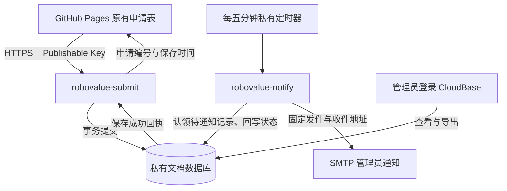

# 设计与数据流

## 1. 目标与取舍

目标是：用户通过原有网页提交申请，申请可靠保存，团队收到通知后可以查看和导出。保存是提交成功的依据；邮件是后续提醒，邮件失败不能使已保存申请消失。

采用 GitHub Pages + CloudBase 云函数 + 文档数据库 + 现有 SMTP 邮箱。这样保留网页设计，由云服务运行后端，不要求浏览器持有管理密钥，也不需要自行维护服务器或另买域名。

这套实现不是通用工单系统：目前没有“审核中、已联系、已完成”的人工审批流程，没有自动评测、申请人回信或附件上传，也没有申请人查询他人记录的接口。

## 2. 架构与权限



浏览器只获准调用提交函数；通知函数及数据库不对普通客户端开放。Publishable Key 是公开配置，不是管理员身份。安全域名限制是浏览器访问配置的一部分，不能代替服务端校验、权限规则或限额。

生产环境为 `robovalue-eval-d6gvbrl7g1fa30d73`，地域 `ap-shanghai`。两个业务函数都是 Event 类型，由原生调用通道或私有定时器执行；不能因此将通知函数也公开。

## 3. 一次 Submit 的完整过程

1. 前端检查必填字段和联系方式。无效输入留在表单中修正，不发请求。
2. 为本次申请准备 UUID v4 及请求正文。按钮显示 `Submitting…` 和加载图标，表单暂时不可编辑，避免同一页面连点。
3. 浏览器发送 HTTPS 请求，最多等待约 20 秒。没有自动循环提交。
4. 函数检查业务开关、请求大小、字段、申请编号和可信来源 IP。来源缺失时拒绝保存，不能使用用户填写的 IP 或伪造请求头补足。
5. 数据库事务先查相同申请编号，再检查限额；新申请、限额计数、待通知状态、五分钟汇总计数一起提交。
6. 只有后端确认保存，且前端验证回执编号和时间有效后，才显示原有成功页面。发邮件不在这个等待链路内。
7. 私有定时任务随后处理通知；管理员可以直接在数据库查看，无需等邮件。

### 接口约定

原生接口：

```text
POST https://{env}.api.tcloudbasegateway.com/v1/functions/robovalue-submit
Authorization: Bearer {Publishable Key}
Content-Type: application/json
```

示例正文（合成数据）：

```json
{
  "idempotencyKey": "11111111-1111-4111-8111-111111111111",
  "application": {
    "teamName": "Example Team",
    "organization": "Example Lab",
    "modelName": "Example Model",
    "email": "team@example.com",
    "contacts": { "wechat": "example_team" }
  }
}
```

请求整体上限 16 KiB。团队、机构、模型名、邮箱分别限制为 120、160、160、254 字符；至少提供一种有效的附加联系方式。前后端都会校验，后端是最终依据。平台保留的 `tcbContext` 由运行适配层剥离，不用于用户身份、IP 或业务字段。

业务结果可能直接返回，也可能包在平台的 `result` 中。**不能只看 HTTP 200 就认为申请成功**，还要解析函数的业务结果：

| 业务结果 | 含义与前端行为 |
| --- | --- |
| `201`，有效 `applicationId`、`submittedAt` | 新申请已保存；显示成功页 |
| `200`，同一编号及原保存时间 | 同一份申请已保存过；仍显示成功，不新增记录 |
| `429 / RATE_LIMITED`，已知 `limitType` 和有效重试秒数 | 限额等待，详见第 6 节 |
| `503 / NOT_ENABLED` | 服务被业务开关关闭；留在表单，提示稍后重试 |
| 其他错误、回执不匹配、超时、断网、平台拒绝 | 保存结果未确认；保留输入，允许重试，不显示成功 |

### 为什么需要幂等编号

网络超时有两种可能：未保存，或已经保存但回执未到达。重试未修改的同一份表单时继续使用原编号，后端用编号和正文哈希识别，避免重复写入和重复占用配额。相同编号但不同正文返回 `409`，不会覆盖原申请。

前端编辑字段后会重新准备申请编号；刷新或关闭页面会丢失内存中的填写内容和编号。因此，幂等只保护保留了原编号的重试，不是对所有内容相近的表单永久去重。浏览器中止等待也不等于取消了云端事务。

## 4. 数据结构与可读性

业务数据保存在 `evaluation_applications`。示例省略了真实联系方式及内部哈希：

```json
{
  "_id": "11111111-1111-4111-8111-111111111111",
  "applicationId": "11111111-1111-4111-8111-111111111111",
  "application": {
    "submittedAt": "2026-10-20T15:10:00.000Z",
    "teamName": "Example Team",
    "organization": "Example Lab",
    "modelName": "Example Model",
    "email": "team@example.com",
    "contacts": { "wechat": "example_team" }
  },
  "notification": {
    "status": "pending",
    "attempts": 0,
    "nextAttemptAt": 1792509000000,
    "leaseUntil": 0,
    "windowStart": 1792509000000
  },
  "payloadHash": "<由后端生成的正文 SHA-256>"
}
```

| 信息块 | 用途 |
| --- | --- |
| `_id`、`applicationId` | 数据库文档键和业务申请编号；当前取相同 UUID，便于按编号查找和安全重试 |
| `application` | 用户填写内容及后端生成的保存时间，集中在一起阅读 |
| `notification` | 通知执行状态、重试和租约信息，不是人工审核状态 |
| `payloadHash` | 判断同一编号的正文是否一致，不是用户身份或公开访问凭证 |

控制台可能按字段名字母顺序显示，不能依靠 JSON 属性顺序实现排版。分块的目的在于让业务字段不会再被内部通知字段打散。旧测试记录未迁移，仍可能看到原来的平铺结构；新申请采用上述结构。

### 时间及通知字段

- `application.submittedAt`：服务器生成的 UTC ISO 时间，紧邻申请信息；不是用户电脑的时间。
- `notification.windowStart`：所属五分钟段的起点，Unix 毫秒；重试不会改所属申请时间段。
- `nextAttemptAt`、`leaseUntil`：Unix 毫秒；分别表示最早可重试时间和认领租约到期时间。
- `notifiedAt`、`failedAt`：对应状态发生时的 UTC ISO 时间；状态满足条件时才存在。
- `status`：`pending → sending → sent`；失败可以回到 `pending`，达到上限或记录无效时为 `failed`。
- `attempts`：认领时增加；`leaseToken` 防止旧执行者覆盖新执行者的状态；`messageId` 帮助定位通知。

**已有的是 `notification.status = "sent"`，没有额外的 `sent: true`。** 它表示 SMTP 接受目标地址且状态已写回，不表示收件箱已收到、已读或团队已处理申请。

辅助集合 `evaluation_rate_limits` 同时保存 IP 配额、全站配额、窗口汇总、定时任务认领和运行告警。不要把这些记录当作申请，也不要手工删除其中一部分来“清空队列”。

## 5. 前端显示规则

不为每种失败单开页面：保留一份表单、一处状态文案和一条帮助说明。

| 状态 | 按钮与提示 |
| --- | --- |
| 待提交 | `Submit Application` |
| 请求中 | 按下色、加载图标、`Submitting…`；暂时禁用表单和按钮 |
| 成功回执 | 原有成功页及后续流程入口 |
| 超时、断网、未知错误 | `Try again`；说明结果未确认、输入仍保留；不强加倒计时 |
| 单 IP 分钟限额或全站十分钟限额 | 灰色等待按钮及 `mm:ss`；到期可再试 |
| 单 IP 或全站每日限额 | 灰色按钮；显示按用户本地时区格式化的恢复日期和时间 |
| 业务开关关闭 | 说明暂不可用、输入保留、稍后再试 |

只有业务响应明确给出合法限额类型和 1–86400 秒重试时间，才启动等待。普通平台 `429` 或未知错误不会编造倒计时。倒计时结束表示允许再次尝试，不保证届时配额一定有空位。

失败提示位于按钮下方。帮助文案为：

> Still unable to submit? Scan a QR code on the right to join our community and contact the team.

手机端将 `on the right` 换为 `below`。可重试按钮搭配蓝色帮助文字，灰色等待按钮搭配紫色帮助文字。没有增加多余的 Need Help 页面。

## 6. 限额及防滥用边界

计数针对**成功保存的新申请**，不是所有 HTTP 请求。相同申请的有效回执重试在事务中优先返回，不再扣新申请配额。

| 范围 | 默认限额 | 窗口与恢复 |
| --- | --- | --- |
| 同一 IP | 10 份/分钟 | 自然分钟边界后重查 |
| 同一 IP | 100 份/天 | UTC 自然日，次日 00:00 UTC，即北京时间 08:00 |
| 全站 | 100 份/连续十分钟 | 真正滚动窗口，较早保存移出后逐步释放 |
| 全站 | 1000 份/天 | UTC 自然日重置 |

同 IP 同时达到分钟和日限额时返回日限额；全站日限额在全站滚动限额之前检查。返回的是当次检查最先命中的原因。

来源 IP 只取平台 SDK 的可信上下文，再用服务端密钥做 HMAC。数据库不保存原始 IP。IP 限额不能区分共享网络内所有人，也不能阻止攻击者轮换 IP；全站限额作为补充。

字段白名单、大小限制、幂等、事务限额、私有权限和固定收件人共同降低滥用风险，但**没有承诺消除自动化攻击**。已拦下的请求仍可能消耗网关、函数、数据库读操作；安全域名和公开 Key 也不能当作防机器人凭证。

关闭超额按量是费用取舍：套餐内正常工作，额度用尽可能受限；不是关掉后端，也不是保证整个腾讯云账号永远零额外费用。不要为了可用性擅自重新打开超额。

## 7. 五分钟申请通知与积压

定时器 `robovalue-notifications-every-five-minutes`：`0 */5 * * * * *`，调用私有 `robovalue-notify`。当前使用现有 163 SMTP 发件账号和管理员配置的固定收件地址，不给申请人自动回信。

- 每份申请按**保存时间**归入固定五分钟段，左闭右开。例如 14:00:00–14:05:00 的申请，在该段结束后处理。
- 每个调度轮次至多认领一份申请邮件，最多 20 条；优先最早仍待通知的已结束时间段，不把不同时间段混进一封申请邮件。
- 工作时间预算、错误、重试等待可能使一封少于 20 条，或使整轮没有申请邮件。不能承诺提交后恰好五分钟内送达。
- 正文显示申请所属时间段、北京时间（UTC+8）、本封数量、本封外仍待通知数量、统计时间，以及用户填写的所有字段、提交时间、Application ID、后台入口。
- 若本时间段本封之外仍有待通知申请，标题使用 `[申请积压]`，正文明确提醒可直接去后台查看。否则使用 `[新申请]`。
- 不同旧时间段也可能排队，因此 `[新申请]` 只代表所处理时间段本封外无待通知记录，不能据此断言全库绝无其他积压。

例如某时间段有 45 条，在后续三个正常调度轮次中可能分成 20、20、5 条，分别显示该段剩余 25、5、0 条。原时间段始终保留。邮件数量取决于工作预算与重试情况，这个例子不是时延保证。

汇总计数与申请在同一事务保存；通知成功后也用一笔事务回写整批状态和剩余数，避免批量并行修改同一计数造成冲突。租约及每轮任务认领防止多个执行者轻易重复认领。

### 失败、重试与重复邮件

每条申请通知最多认领 8 次。重试延迟按 1、2、4、8、16、32、64 分钟增长；实际执行还要等后续定时器，且较早待处理时间段可能阻塞较新的时间段。运行中断后，过期的 120 秒租约可以重新认领。

SMTP 与数据库不是同一个事务。邮件可能已被接受，但状态写回超时，此时允许后续重试，可能出现重复邮件；应按 Application ID 核对，不冒险将未确认结果直接标记成功。达到上限进入 `failed`，申请仍保留，需管理员排查；无效记录也可能直接停止重试。

邮件是纯文本。用户字段只进入有长度限制、去除控制字符的正文，不进入主题、收件人、附件或邮件头。联系人信息进入邮件是本次明确选定的行为，收件邮箱因此也成为个人信息存储位置，不宜公开转发。

## 8. 运行告警与晚到事件

限额、可信来源不可用、保存结果未确认、通知发送失败、状态写回未确认、重试耗尽、通知任务异常会尝试记录运行事件。每五分钟按类别合并，不为每次被拦请求单独发信，也不把合并数量冒充攻击次数或受影响人数。

每轮至多另发一封告警邮件，和申请邮件分开。告警包含类别、原观察时间、影响、已知恢复时间、后台入口；不附原始 IP、联系方式、密钥或任意异常堆栈。

**一旦告警批次被认领发送，就冻结其内容，失败等待重试也不再往里面追加。** 发送期间新出现的类别转入后续可写批次，保留原发生时间和所属时间段，并在邮件标出“本封补报”。这样不会把未进入邮件的晚到事件随旧批次误标为已通知。

这不是独立外部监控：数据库完全不可用时事件也可能存不下；CloudBase 或 SMTP 整体不可用时告警可能延迟或发不出去；业务开关关闭或平台在进入函数前拒绝请求时，也不保证生成业务告警。不要把“没收到邮件”理解成“没有故障”。
